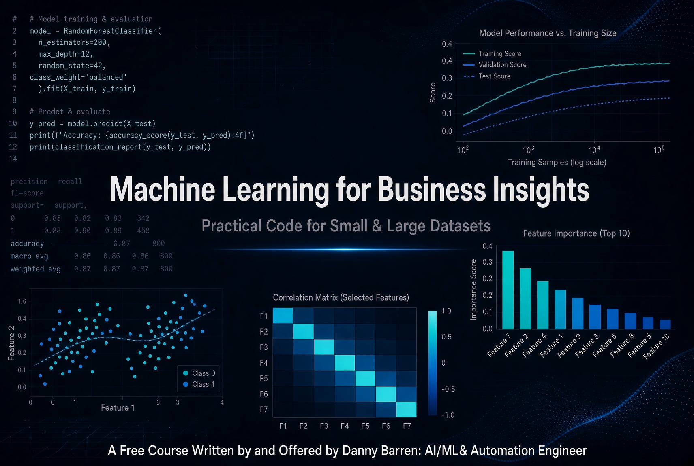

# Machine Learning for Business Insights

### Plug-and-Play Code for Small and Large Datasets

**A free, practical course for business owners, managers, and corporate professionals who want real insights from their data — without becoming data scientists.**

---

## Why This Course?

Most machine learning courses are either too theoretical or focused on deep learning that requires massive datasets. This course is different.

You get **complete, commented Python notebooks** that you can plug your own data into. The focus is on classical machine learning algorithms that work well on both very small datasets (dozens to hundreds of rows) and larger ones. You’ll learn how to extract **actionable business insights**, not just accuracy scores.

No neural networks. No unnecessary complexity. Just practical models, hyperparameter tuning, and clear interpretation.

---

## Who This Is For

- Business owners and operators who want to get more from their data
- Corporate professionals and analysts who can copy-paste and run code
- Anyone who wants interpretable models and clear business recommendations
- People with small datasets who have been told “you don’t have enough data for ML”

**You do not need to be a data scientist.** Basic comfort with Excel and the ability to open a Jupyter notebook (or Google Colab) is enough.

---

## What You Will Learn

- When machine learning is worth using versus simpler analysis
- How to prepare data and avoid common pitfalls (especially with small data)
- Practical models: Linear & Logistic Regression, Decision Trees, Random Forests, Gradient Boosting, and Clustering
- Hyperparameter tuning that actually improves results without overfitting
- How to interpret models and turn predictions into decisions (feature importance, coefficients, thresholds, expected value)
- Techniques that work reliably on both small and large datasets

---

## Course Structure

| Module | Lesson | Notebook |
|---|---|---|
| 1. When to Use ML (and When Not To) | [Lesson](lessons/module_01_when_to_use_ml.md) | Built into every notebook |
| 2. Data Prep Essentials | [Lesson](lessons/module_02_data_prep.md) | Built into every notebook |
| 3. Regression for Forecasting and Drivers | [Lesson](lessons/module_03_regression.md) | [01 · Linear Regression](notebooks/01_linear_regression.ipynb) |
| 4. Classification for Yes/No Decisions | [Lesson](lessons/module_04_classification.md) | [02 · Logistic Regression](notebooks/02_logistic_regression.ipynb) |
| 5. Tree-Based Models and Ensembles | [Lesson](lessons/module_05_tree_models.md) | [03 · Decision Tree](notebooks/03_decision_tree.ipynb) · [04 · Random Forest](notebooks/04_random_forest_churn.ipynb) · [05 · Gradient Boosting](notebooks/05_gradient_boosting.ipynb) |
| 6. Clustering and Customer Segmentation | [Lesson](lessons/module_06_clustering.md) | [07 · Clustering / Segmentation](notebooks/07_clustering_segmentation.ipynb) |
| 7. Hyperparameter Tuning and Validation | [Lesson](lessons/module_07_tuning.md) | Tuning sections inside notebooks 01–06 |
| 8. Interpreting Results and Turning Them into Decisions | [Lesson](lessons/module_08_interpretation.md) | Interpretation sections inside notebooks 01–06 |
| 9. End-to-End Templates and Case Studies | [Lesson](lessons/module_09_end_to_end.md) | [06 · End-to-End Churn](notebooks/06_end_to_end_churn.ipynb) |

---

## Notebooks (Open in Colab)

Each notebook runs end to end on synthetic demo data when you leave `CSV_PATH = None`. To use your own data, change the file path and a few column names in the **CONFIG** cell.

| Notebook | Open in Colab |
|---|---|
| [01 · Linear Regression](notebooks/01_linear_regression.ipynb) — sales / demand forecasting |  |
| [02 · Logistic Regression](notebooks/02_logistic_regression.ipynb) — churn / lead scoring |  |
| [03 · Decision Tree](notebooks/03_decision_tree.ipynb) — classification or regression |  |
| [04 · Random Forest Churn](notebooks/04_random_forest_churn.ipynb) — ranking customers to contact |  |
| [05 · Gradient Boosting](notebooks/05_gradient_boosting.ipynb) — classification or regression |  |
| [06 · End-to-End Churn Case Study](notebooks/06_end_to_end_churn.ipynb) — data → decisions |  |
| [07 · Clustering / Segmentation](notebooks/07_clustering_segmentation.ipynb) — customer segments for Module 6 |  |

---

## How to Use This Repository

1. **Read the lesson** for the module you care about (plain-language Markdown in [`lessons/`](lessons/)).
2. **Open the matching notebook in Google Colab** with the badges above (zero local setup).
3. **Edit only the CONFIG cell**: file path, target column, feature columns, and (for classification) rough business numbers like cost to contact and value of a save.
4. **Run top to bottom.** Comments explain what each step means for the business.
5. **Use the interpretation and recommendations sections** to turn scores into actions.

### Small vs. large data

Notebooks auto-detect size (or you can set `DATA_SIZE_MODE`). On **small** data they use repeated cross-validation, smaller search grids, and stronger simplification. On **large** data they use fewer folds and may tune on a sample. Prefer a simpler model when it ties a more complex one.

---

## Requirements

Listed in [`requirements.txt`](requirements.txt):

- `pandas`, `numpy`
- `scikit-learn` ≥ 1.2
- `matplotlib`, `seaborn`, `scipy`, `joblib`

Optional upgrades (XGBoost, LightGBM) are noted inside some notebooks; they are not required.

---

## Philosophy

This course prioritizes:

- **Simplicity** over sophistication
- **Interpretability** over black-box accuracy
- **Actionable insights** over leaderboard metrics
- **Working with the data you actually have** (including small datasets)

You will leave with working templates and the ability to generate insights from your own data.

---

**Built for business people who want results.**

[Danny Barren](https://github.com/DannyBarren) · [dannybarren.com](https://dannybarren.com)

